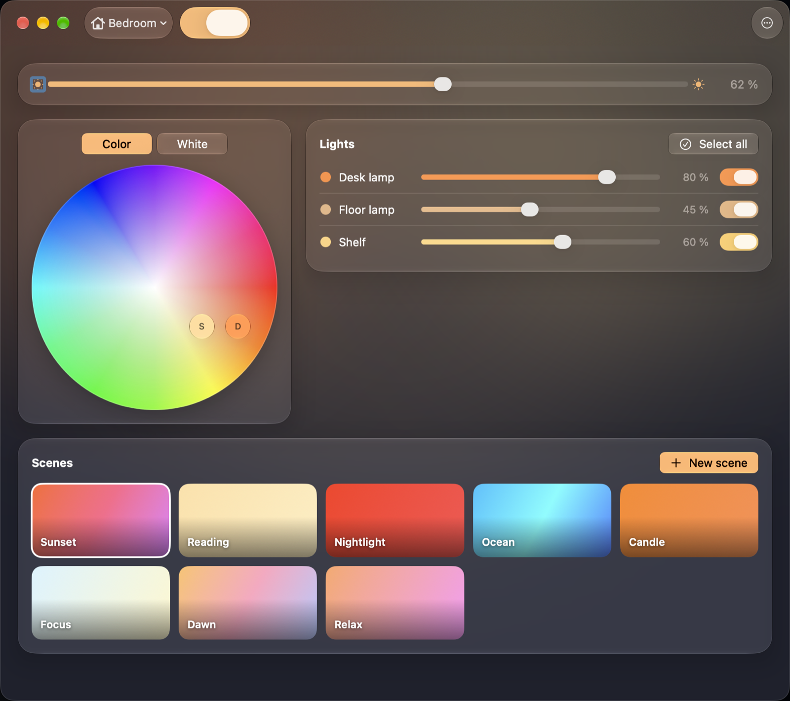
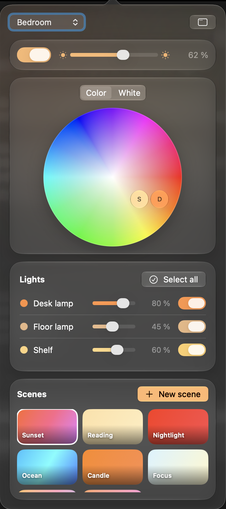

# Glow

A Mac menu bar app for Philips Hue lights.

<p>
  
  
</p>

## Features

- Rooms, with brightness per light and per room
- A color wheel for color bulbs and a temperature bar for white bulbs
- Group or sync lights by selecting several, or by dropping one on another
- Recall, create, update, rename and delete scenes
- Live sync with the Hue app
- Menu bar popover and a full window; Glow leaves the Dock when the window is closed
- English and French

## Requirements

- A Mac with macOS 26 or later
- A Philips Hue Bridge on the same network

## Install

1. Open the [latest release](https://github.com/samcok/glow/releases/latest) and download `Glow.zip`. Safari unzips it for you; with another browser, double-click the zip.
2. Drag **Glow** into your **Applications** folder.
3. Open Glow. Glow is not notarized by Apple yet, so macOS blocks the first launch with a message saying it can't verify the app. Click **Done** (not Move to Trash).
4. Open **System Settings > Privacy & Security**, scroll down to **Security**, and click **Open Anyway** next to the line about Glow. Confirm with your password or Touch ID, then click **Open**. You only do this once.

## First launch

1. When macOS asks whether Glow can find devices on your local network, click **Allow**. Without it, Glow can't see your bridge.
2. Glow looks for your bridge and shows it as "Hue Bridge (192.168.x.x)". Click it. If it doesn't show up, type the bridge's IP address (you'll find it in the Hue app under Settings > Bridges).
3. Press the round link button on top of the bridge within a minute. Your rooms appear a few seconds later.

Glow lives in the menu bar: click the bulb icon for quick controls, right-click it to open the full window. Closing the window removes Glow from the Dock; it keeps running in the menu bar. On a Mac with a notch, a crowded menu bar can hide the icon behind the notch. To start over with another bridge, choose **Forget bridge** from the right-click menu.

## Update

Download the new `Glow.zip` and replace Glow in Applications. On first launch of the new version, macOS asks for access to Glow's key in the Keychain: enter your password and click **Always Allow**.

## Build from source

You need the Xcode Command Line Tools.

```
./build.sh --install
```

This builds, signs and zips `build/Glow.app`, and copies it to `~/Applications`.

## Privacy and security

- Glow only talks to your bridge on the local network. It finds it with Bonjour, and asks discovery.meethue.com only if that fails.
- No analytics, no tracking.
- The app key is stored in the macOS Keychain.
- The bridge certificate is pinned on first pairing. If it changes, Glow stops and asks you to pair again.
- The app is sandboxed. To report a vulnerability, see [SECURITY.md](SECURITY.md).

## Limitations

- No entertainment or screen sync
- No remote access, only your local network
- Dynamic scenes are not supported

## License

MIT, see [LICENSE](LICENSE).

## Disclaimer

Glow is not affiliated with or endorsed by Signify. Philips Hue is a trademark of Signify Holding.
